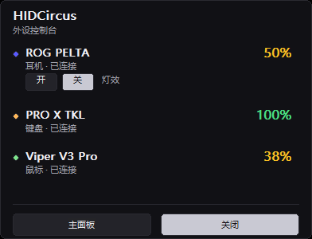
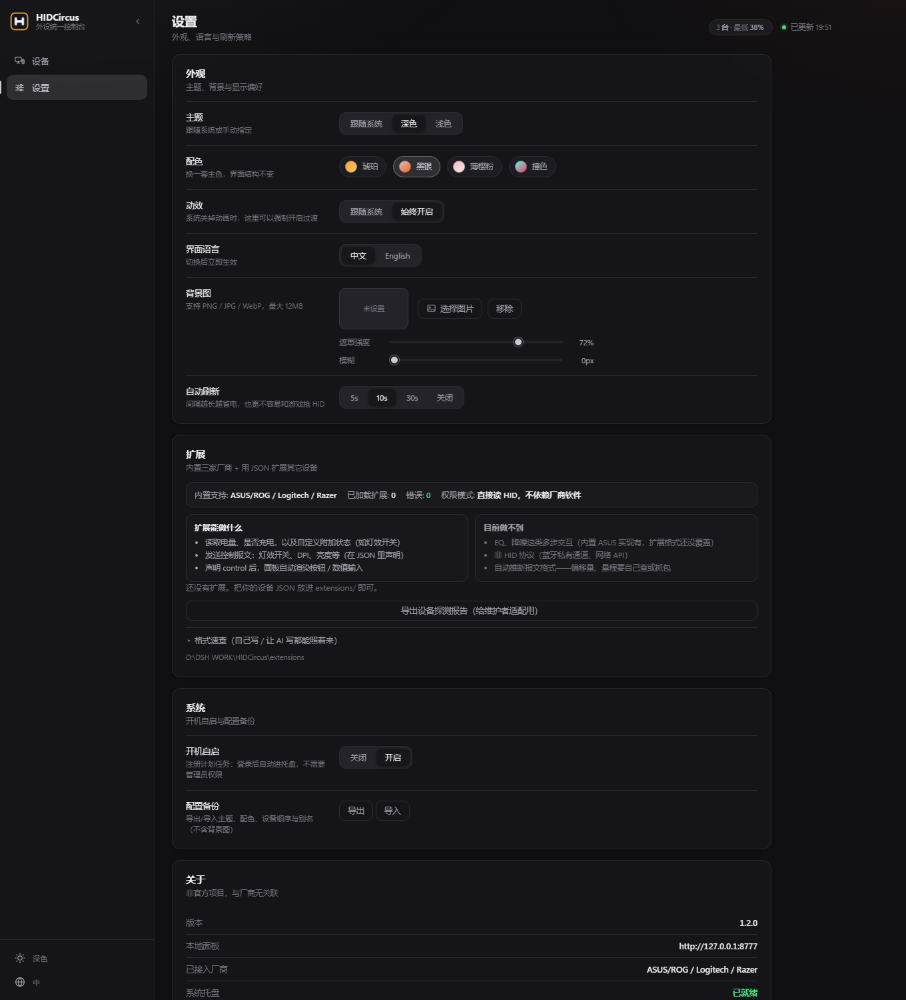
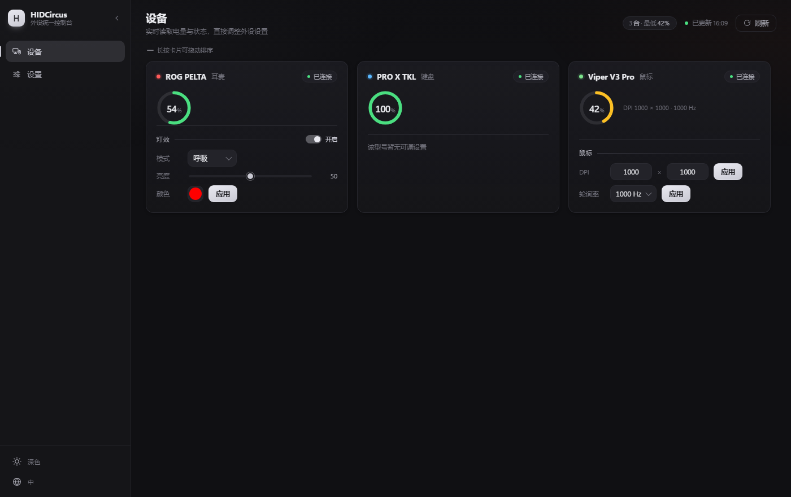

# HIDCircus

One control panel for peripherals from multiple vendors. It stays in the tray: one click shows battery levels and lets you change device settings — no G HUB / Synapse / Armoury Crate required.

[简体中文](README.md) · English

> **Unofficial project.** Not affiliated with Logitech, Razer or ASUS. No vendor trademarks or firmware are included; access is HID-only interoperability.


## Status

| Vendor | Device | Battery | Control |
|---|---|---|---|
| ASUS/ROG | ROG PELTA | ✅ | Lighting (verified) / EQ, ANC protocol reverse-engineered |
| Logitech | PRO X TKL | ✅ | Planned |
| Razer | Viper V3 Pro | ✅ | DPI / polling rate (read-write loop verified) |

## Quick start

**Portable build**

1. Extract `HIDCircus-win-x64.zip` into any writable folder
2. Run `HIDCircus.exe` (one UAC prompt may appear — it is needed to create the tray icon)
3. Left-click the tray icon = native panel, right-click = menu (main panel / refresh / quit)

> The browser is **never opened automatically**. It only opens when you click "Main panel".

**From source**

```powershell
py -3.10 -m venv .venv
.\.venv\Scripts\pip install -r requirements.txt
.\.venv\Scripts\python.exe app.py
```

## Screenshots

| Native tray panel (left click) | Main panel |
|---|---|
|  |  |

| Settings · extensions & system | Color presets |
|---|---|
|  |  |

- **Native tray panel** — GDI-drawn, no browser involved: battery, status, and a lighting on/off switch
- **Battery rings** — each card has a progress ring, the rest of the space is for controls
- **Light / dark / follow-system** themes plus **four color presets** (Silver (default) / Amber / Sakura / Neon)
- **Chinese & English** UI (`web/i18n.js` — add one dictionary to add a language)
- Loading screen on startup, fades into the panel
- **Motion setting** — follow system or always on (useful when the OS disables animations)
- **Custom background image** with dim/blur controls, frosted-glass cards
- **Drag to reorder**, **double-click a name to rename**, **import/export settings**
- **Start at login** toggle in settings (no admin rights needed)
- Refresh interval 5s / 10s / 30s / off; plug/unplug triggers an immediate refresh

## Tray

- **Left click** — native panel (battery + lighting switch); click again to dismiss
- **Right click** — menu: open panel / main panel / refresh battery / quit

## Extensions: adapt uncommon devices yourself

Nobody can write an adapter without the actual hardware. So the read path is a
**declarative JSON extension**: someone who owns the device (or their AI agent) describes
the packets, drops a JSON file into `extensions/`, and it works — no Python changes.

- Format reference and debugging: [extensions/README.md](extensions/README.md)
- Working examples: [extensions/examples/](extensions/examples/)
- Export your adapter from *Settings → Extensions* and send it back to widen official support
- No adapter yet? Export a **device probe report** and attach it to an issue

## About supporting more devices

**Other models from the same vendor** — read as much as possible. The known-device table only
provides names; unknown PIDs are probed with the same command family (battery → charging →
lighting / DPI / polling rate). Whatever responds is shown, otherwise the device is marked
"not adapted yet".

**Other vendors** — every vendor uses a private protocol (Logitech HID++, Razer 91-byte feature
reports, ASUS 0xCC packets…). There is no universal reader. This project has three layers:

1. **Dedicated providers** (`providers/asus.py` / `logitech.py` / `razer.py`) — accurate reads and
   full control, but each needs adaptation
2. **JSON extensions** (`extensions/`) — written by users, no code changes
3. **Generic fallback** (`providers/generic.py`) — Windows battery API; battery only, no control

**Gamepads** — Windows has no unified gamepad battery API; Xbox and DualSense each use private
reports. Not implemented (needs hardware to verify).

## Optional one-time setup

Run `setup.bat` to register start-at-login and create a desktop shortcut.

```powershell
setup.bat              # install
setup.bat uninstall    # remove
```

> HIDCircus does **not** need administrator rights; a normal user account is enough. Only when
> the session itself has been de-privileged (e.g. launched from a sandboxed file manager) does it
> request one UAC elevation — and it does that automatically.

## Build

```powershell
powershell -ExecutionPolicy Bypass -File build.ps1
# -> dist\HIDCircus\HIDCircus.exe and dist\HIDCircus-win-x64.zip
```

> onedir is used instead of onefile: a single-file build extracts itself into `%TEMP%` on every
> start, which fails with `Could not create temporary directory!` in restricted environments.

## Architecture

```
app.py          Desktop entry: local server + tray + native panel + browser window
server.py       Local HTTP server (pages, device API, settings, background, auth)
flyout.py       Native panel (GDI, browser-free)
tray.py         Tray icon (Shell_NotifyIcon)
providers/
  base.py       Device model + Provider base class
  asus.py       ROG headsets (0xCC packets, 0x12 read / 0x41·0x51 write)
  logitech.py   HID++ 2.0 (0x1004 battery)
  razer.py      91-byte feature reports
  extension.py  Declarative JSON extension loader
  generic.py    Windows battery API fallback
web/            Page shell / design system / state & rendering / i18n
tests/          Protocol, extension loading, smoke tests
extensions/     Extension format docs and examples
```

Adding a vendor = one file implementing `scan()` / `control()` plus one line in
`providers/__init__.py`; or a JSON file in `extensions/` with no code changes at all.

## License & compliance

- MIT. Protocols are independent implementations; no GPL code was copied (noted in each provider header)
- No vendor trademarks or logos are used; this README carries an unofficial disclaimer
- No DRM circumvention, no firmware flashing
- All endpoints bind to `127.0.0.1` only; write endpoints require a random per-session token

## Protocol references

Behaviour was derived from publicly documented observations in these projects; this repository is
an independent implementation and does not copy their code:

- [Solaar](https://github.com/pwr-Solaar/Solaar) (GPL-2.0) — Logitech HID++
- [OpenRazer](https://github.com/openrazer/openrazer) (GPL-2.0) — Razer
- [viper-tray](https://github.com/damianyoko/viper-tray) (MIT) — Razer feature reports
- [G-Helper](https://github.com/seerge/g-helper) (GPL-3.0) — ASUS headsets

## Caveats

- Vendor software (G HUB / Synapse / Armoury Crate) may hold the HID channel; close it while using this tool
- Write operations change device settings (DPI, polling rate, lighting) — double-check before applying
- This project does not flash firmware

Development notes and a 40-entry pitfall list: [HANDOVER.md](HANDOVER.md). Changes: [CHANGELOG.md](CHANGELOG.md).
