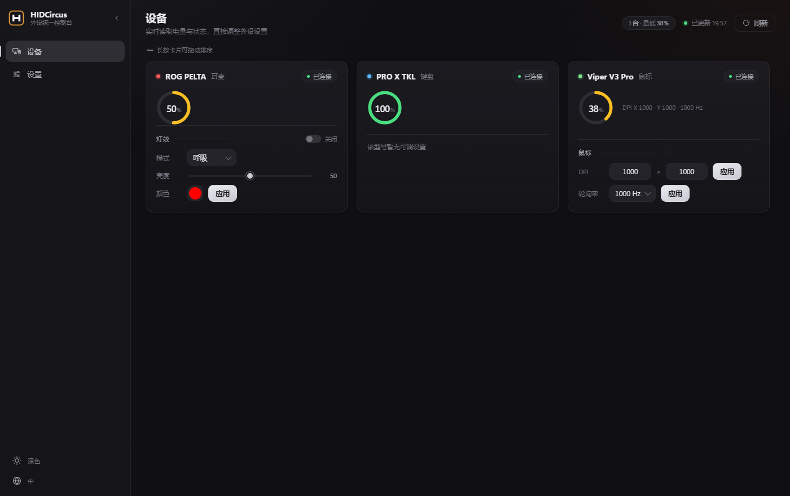
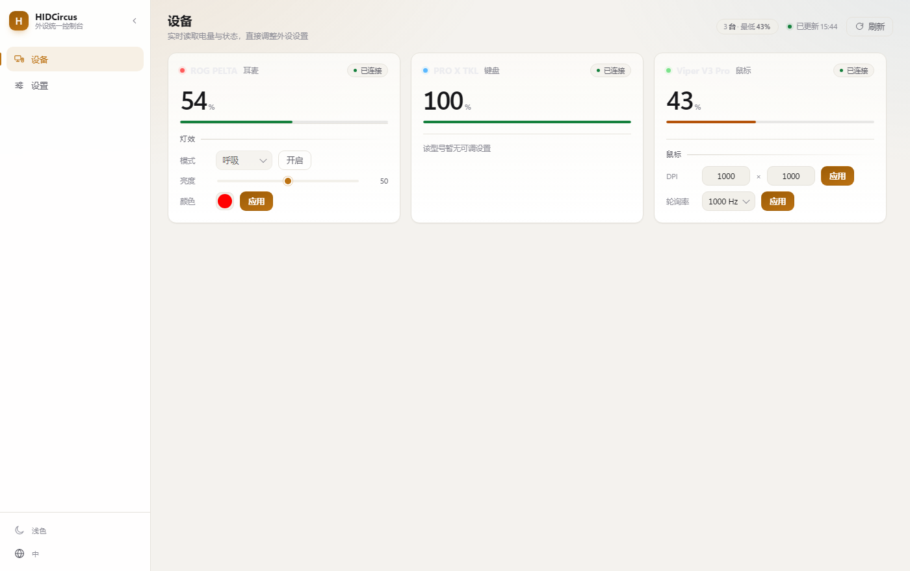
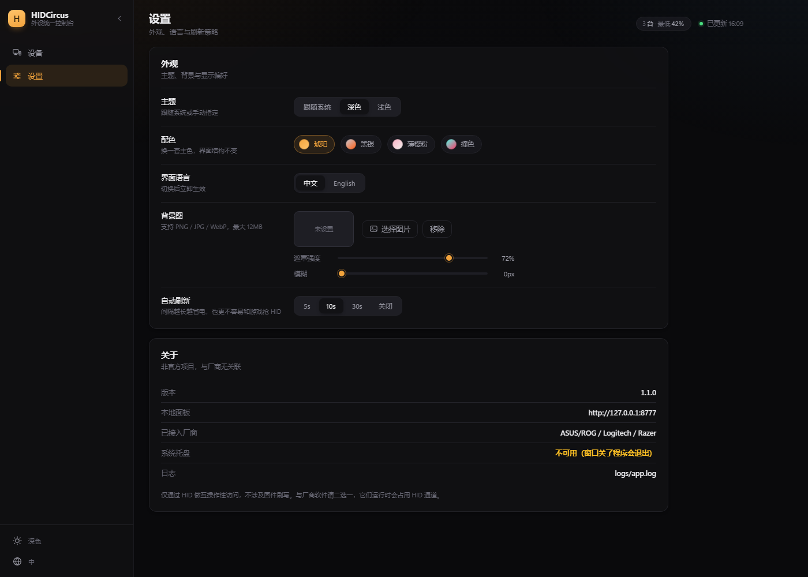

# HIDCircus

多厂商外设统一控制台。后台常驻，点开就能看电量、直接改外设设置，不需要 G HUB / Synapse / Armoury Crate。

> **非官方项目**，与 Logitech、Razer、ASUS 均无关联。不含厂商商标与固件，仅通过 HID 做互操作性访问。



## 当前状态

| 厂商 | 设备 | 电量 | 控制 |
|---|---|---|---|
| ASUS/ROG | ROG PELTA | ✅ | 灯效（已实测）／EQ、降噪协议已通 |
| Logitech | PRO X TKL | ✅ | 规划中 |
| Razer | Viper V3 Pro | ✅ | DPI / 轮询率（读写闭环已实测） |

## 界面

| | |
|---|---|
|  |  |

- **环形电量**：每张卡片一个进度环，剩下的空间留给设备设置项
- **亮 / 暗 / 跟随系统**三档主题 + **四套配色预设**（琥珀 / 黑银 / 薄樱粉 / 撞色）
- **中英双语**切换（`web/i18n.js` 加一份语言即可扩展）
- 启动有加载页，数据就绪后淡入主面板
- **动效**可设「跟随系统 / 始终开启」：系统关掉动画时也能保留过渡
- **自定义背景图**，可调遮罩强度与模糊；侧栏与卡片是毛玻璃，背景会透上来
- **长按卡片拖动排序**，顺序存在 `config.json` 里
- **双击设备名改别名**（留空恢复原厂名），托盘面板也用这个名称
- **配置备份**：设置页导出/导入主题、配色、设备顺序与别名
- **开机自启开关**：设置页一键注册/取消计划任务（不需要管理员权限）
- 设备多时列表自然滚动，卡片等高排列
- 自动刷新间隔可设（5s / 10s / 30s / 关）；插拔设备会立刻刷新

## 快速上手

**便携版**

1. 解压 `HIDCircus-win-x64.zip` 到任意可写目录
2. 双击 `HIDCircus.exe`（首次可能弹一次 UAC，用于创建托盘图标）
3. 托盘左键 = 原生面板，右键 = 菜单（主面板 / 刷新 / 退出）

> 启动后**不会自动打开浏览器**。只有点「主面板」时才打开网页版详细设置。

**源码运行**

```powershell
py -3.10 -m venv .venv
.\.venv\Scripts\pip install -r requirements.txt
.\.venv\Scripts\python.exe app.py
```

## 一次性配置（推荐先做）

双击 `setup.bat`：注册开机自启 + 桌面快捷方式，之后**每次都按正常权限启动，不会再弹 UAC**。

```powershell
setup.bat              # 安装
setup.bat uninstall    # 卸载
```

> 为什么不直接用管理员权限跑：本工具不需要管理员权限，只要"普通用户权限"。
> 之前的权限问题是因为从受限入口（某些工具的沙箱文件管理器）启动导致被降权。
> 走计划任务启动可以绕开这个继承链。

## 托盘

- **左键**：弹出小面板（三台设备的电量一览，点空白处自动收起）
- **右键**：菜单 —— 打开主面板 / 刷新电量 / 退出

## 运行

双击 `run.bat`：起本地服务 + 托盘 + 面板窗口。窗口关掉服务还在，托盘菜单里可以再打开或退出。

```powershell
run.bat      # 无控制台
debug.bat    # 带控制台，能看错误
panel.bat    # 只开面板窗口（服务已在跑时用）
```

首次使用需要装依赖（已建好 `.venv` 可跳过）：

```powershell
py -3.10 -m venv .venv
.\.venv\Scripts\pip install -r requirements.txt
```

启动情况、托盘是否就绪、任何异常都记在 `logs\app.log`。

> 窗口用的是 Edge 的 `--app` 模式：没有地址栏和标签页，本质是一个独立窗口，
> 前端跑在 Chromium 上，所以 CSS 能力完整，和浏览器面板是同一套页面。

## 打包

```powershell
powershell -ExecutionPolicy Bypass -File build.ps1
# 输出 dist\HIDCircus.exe
```

## 架构

```
app.py          桌面入口：本地服务 + 托盘 + 面板窗口
server.py       本地 HTTP 服务（页面、设备 API、设置、背景图）
providers/
  base.py       统一设备模型 + Provider 基类
  asus.py       ROG 耳机（0xCC 报文，0x12 读 / 0x41·0x51 写）
  logitech.py   HID++ 2.0（0x1004 读电量）
  razer.py      91 字节 feature report
web/
  index.html    页面骨架
  app.css       视觉系统（设计变量 / 组件 / 主题）
  app.js        状态、渲染、设置持久化
  i18n.js       中英文案
run.bat / debug.bat / panel.bat / build.ps1
```

新增厂商 = 加一个 `providers/xxx.py`，实现 `scan()` / `control()`，再在 `providers/__init__.py` 注册一行。

## 合规

- MIT；协议为独立实现，未复制 GPL 项目代码（各 provider 文件头已注明）
- 不使用厂商商标/logo；README 有非官方免责声明
- 不涉及 DRM 绕过、固件刷写

## 扩展：自己适配冷门外设

没有原版设备就没法盲写适配，所以读取部分做成了**声明式 JSON 扩展**：
有设备的用户（或他的 AI agent）照着协议填一份 JSON 放进 `extensions/` 就生效。

- 格式说明与调试方法：[extensions/README.md](extensions/README.md)
- 参考实现：[extensions/examples/](extensions/examples/)
- 适配好了可以在「设置 → 扩展」里**一键导出**，回传给项目做更广的适配
- 没适配的设备也能点「导出设备探测报告」，把接口信息发回来

## 关于"支持更多设备"

**同品牌的其它型号**：能读到多少算多少。已知型号表只提供名字，其它型号会用同一套命令
逐项试探（电量 → 充电 → 灯效 / DPI / 轮询率），读到就展示，读不到就标"该型号尚未适配"。

**不同品牌**：每家的电量/控制都是私有协议，必须一家一个 provider（`providers/xxx.py`）。

**手柄**：Windows 没有统一的手柄电量接口，Xbox / DualSense 各是一套私有报文，
需要单独适配并且必须有硬件验证，目前未做。

## 关于"支持更多品牌"

每家外设的电量/控制都是私有协议（罗技 HID++、雷蛇 91 字节 feature report、ROG 0xCC 报文……），
**不存在一个读取逻辑通吃所有品牌**。本项目的做法是分两层：

1. **专属 provider**（`providers/asus.py` / `logitech.py` / `razer.py`）：读得准、能控制，但需要逐个适配
2. **通用兜底 provider**（`providers/generic.py`）：走 Windows 电池接口，能读到"系统认得它有电池"的设备
   （蓝牙外设、部分接收器），只能读电量、不能控制。**这一层覆盖面有限，且笔记本自身电池会被过滤掉**

新增品牌只需三步：写一个 `providers/xxx.py` 实现 `scan()` / `control()`，在 `providers/__init__.py` 注册一行。

## 协议来源

协议行为参考了以下开源项目的公开观察结果，本仓库为独立实现，未复制其代码：

- [Solaar](https://github.com/pwr-Solaar/Solaar)（GPL-2.0）— 罗技 HID++
- [OpenRazer](https://github.com/openrazer/openrazer)（GPL-2.0）— 雷蛇
- [viper-tray](https://github.com/damianyoko/viper-tray)（MIT）— 雷蛇 feature report
- [G-Helper](https://github.com/seerge/g-helper)（GPL-3.0）— ASUS 耳机

## 注意

- 厂商软件（G HUB / Synapse）运行时可能占用 HID 通道，建议关闭后使用本工具
- 写操作会直接改设备设置（DPI、轮询率、灯效），请自行确认后再操作
- 本项目不涉及固件刷写

详细开发记录见 [HANDOVER.md](HANDOVER.md)。
